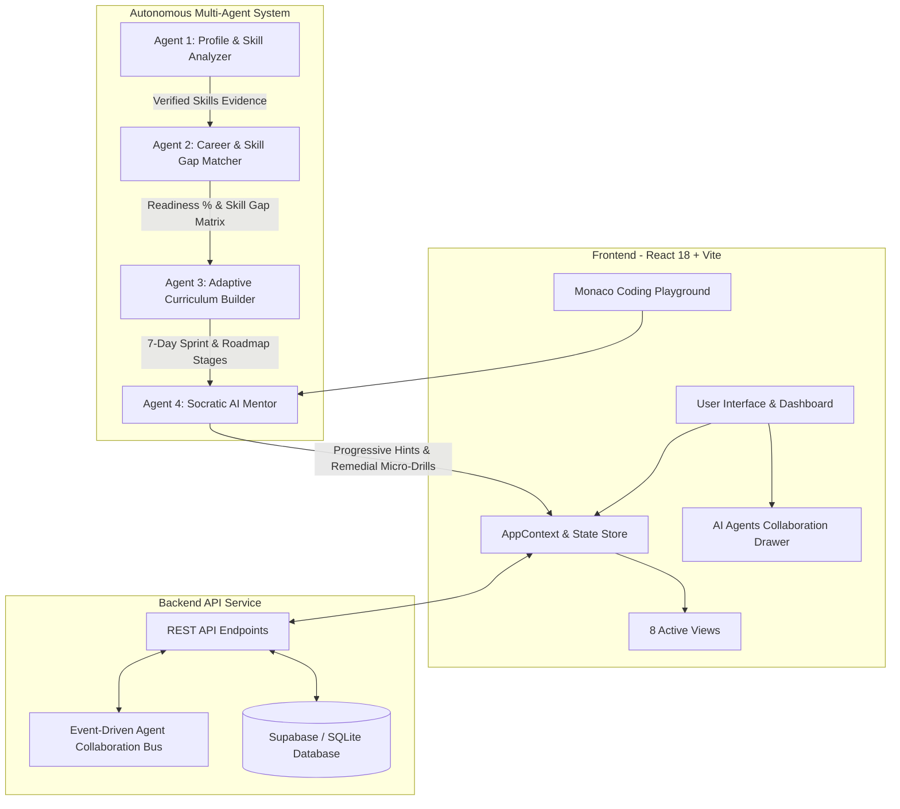

# JOB WAY AI – Architecture & Multi-Agent Specifications

## System Architecture

## The Four Specialized Autonomous Agents

1. **Agent 1 – Profile & Skill Analyzer**:
   - Parses resume text, Markdown, and public GitHub repositories.
   - Extracts programming languages, frameworks, databases, and DevOps tools.
   - Detects skill proficiencies (Beginner, Intermediate, Advanced) and confidence scores.
   - Requires explicit human-in-the-loop review and approval before persisting skills.
   - **Grounding Rule**: Never invents certifications or unvalidated experience.

2. **Agent 2 – Career & Skill Gap Matcher**:
   - Analyzes learner skills against 12 industry career paths.
   - Computes explainable readiness percentage: `(Acquired Weights / Required Weights) * 100`.
   - Generates multi-axis Skill Gap Radar Charts.
   - Powers the "Simulate Career Pivot" tool to contrast transferrable vs missing skills.
   - Categorizes top companies into "High Chance", "Within Reach", and "Reach/Ambition".

3. **Agent 3 – Adaptive Curriculum Builder**:
   - Synthesizes personalized roadmaps across Beginner, Intermediate, and Advanced tiers.
   - Adapts pacing dynamically according to user's weekly study commitment (5 - 40 hrs).
   - Generates high-impact 7-Day Gap Sprints for targeted companies.
   - Inserts prerequisite micro-lessons following failed assessments.

4. **Agent 4 – Socratic AI Mentor**:
   - Operates directly inside the Coding Workspace.
   - Employs Socratic inquiry: guides through hints and questions without dumping raw code.
   - Consecutive Failure Watchdog: 2 failed submissions unlocks progressive Hint #1/#2/#3.
   - Remedial Intervention: Generates a 3-question conceptual micro-drill with immediate rationale feedback.

